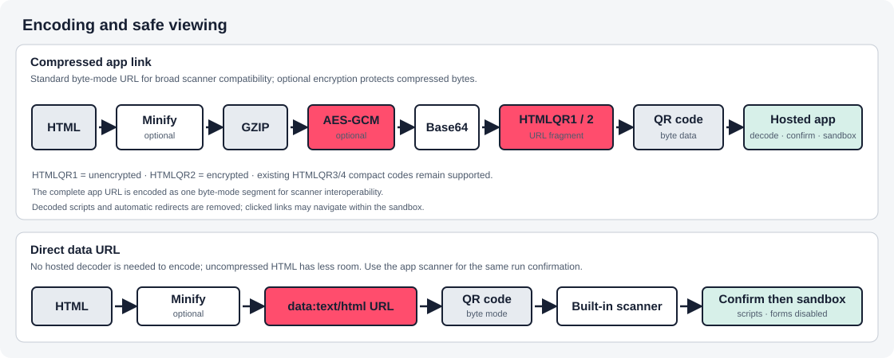

# HTML to QR

**Put a complete, small HTML page inside a single QR code.** Create the code in your browser, scan it with a phone, and view the reconstructed page without uploading the HTML to a server.

[Open HTML to QR](https://html2qr.vercel.app)



## Encoding methods

Choose how the HTML should travel in the QR code:

- **Compress, then decode on a page:** HTML is optionally minified, compressed with GZIP, and encoded as URL-safe Base64 with the `HTMLQR1:` marker. The QR contains a link to this app with the payload in its URL fragment. When opened, the app decodes the content locally and displays it in a sandboxed iframe. Enter the deployed app URL in the workbench so scanning opens the decoder. The page content is carried by the QR; it is not uploaded to the app's server.
- **Convert to a data URL:** HTML is optionally minified and embedded directly in a `data:text/html` URL. This needs no hosting or decoder, but supports less HTML because the uncompressed page must fit in the QR. Some scanner apps display data URLs as text; if that happens, copy the URL into a browser address bar.

Compressed mode also supports an optional password. When set, the compressed bytes are encrypted with AES-256-GCM using a key derived from the password with PBKDF2-SHA-256; the QR uses the `HTMLQR2:` marker and includes a random salt and IV. The person opening the QR must enter the same password. Encryption does not hide the QR's contents from someone who knows the password, and a weak password may be guessed offline.

The built-in minifier removes comments and collapses whitespace while preserving the contents of `script`, `pre`, and `textarea` elements. You can turn minification off in the workbench.

## Create a QR code

1. Open [html2qr.vercel.app](https://html2qr.vercel.app).
2. Choose a method and paste or edit the HTML source.
3. For compressed mode, confirm the hosted app URL is set. The deployed URL is filled in automatically when using the hosted app.
4. Choose an error-correction level and whether to minify. Optionally enter a password to encrypt compressed mode.
5. Use **Live preview** to inspect the current HTML, then select **Generate QR code**.
6. Use **Download PNG** to save the generated code. The built-in **Scan QR** control is available in the app header and decoded-page toolbar; allow camera access and point it at a code.

For encrypted QR codes, enter the password when prompted. Keep it separate from the QR image or link; the app does not store or recover it.


The meter shows the payload size against the selected QR capacity. Higher error correction can make a code more resilient to damage, but leaves room for less data. If a payload exceeds the selected capacity, generation is disabled. Capacity figures are for QR Code Version 40 in byte mode; actual generated codes use the smallest version that fits.

## Run locally

This is a static browser app. Serve the project directory over HTTP (localhost is treated as a secure context by modern browsers):

```sh
python3 -m http.server 8000
```

Then visit <http://localhost:8000>. Compressed mode and password encryption use the browser's `CompressionStream`, `DecompressionStream`, and Web Crypto APIs. QR generation and camera scanning use libraries loaded from CDNs. Camera access requires HTTPS or localhost and browser permission.

To deploy your own copy, host the files as a static site and use that site's base URL in the compressed-mode URL field. The URL must point to the app that will decode the `HTMLQR1:` fragment.

## Privacy and safety

- HTML is processed in the browser; this app does not send the page source to a backend.
- Compressed payloads are stored in the QR code's URL fragment, not as server-side page data.
- Password-protected payloads use AES-GCM authenticated encryption and are decrypted in the browser. The password itself is never put in the QR code.
- Decoded HTML runs in a sandboxed iframe. The sandbox allows scripts, forms, and popups, but does not grant same-origin access.
- A QR code is not encryption. Anyone who scans or obtains the code can read its payload. Do not encode secrets or sensitive information.

## Project files

- `index.html` contains the app interface and page structure.
- `script.js` implements minification, payload encoding/decoding, capacity checks, and QR rendering.
- `qr-burst.js` defines the animated `<qr-burst>` web component used for the intro.
- `style.css` contains the responsive interface styles.

## License

This project is distributed under the [Apache License 2.0](LICENSE). See the license file for the full terms.