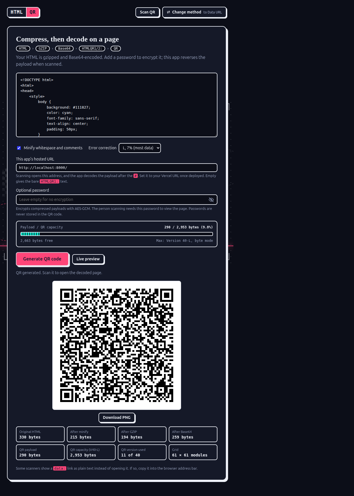
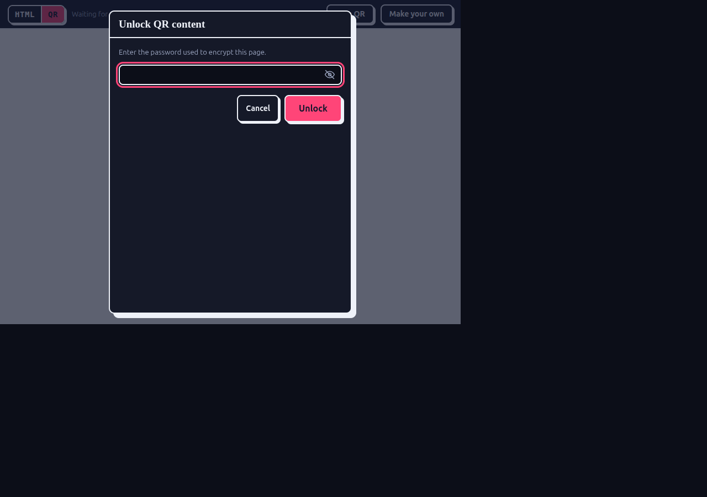
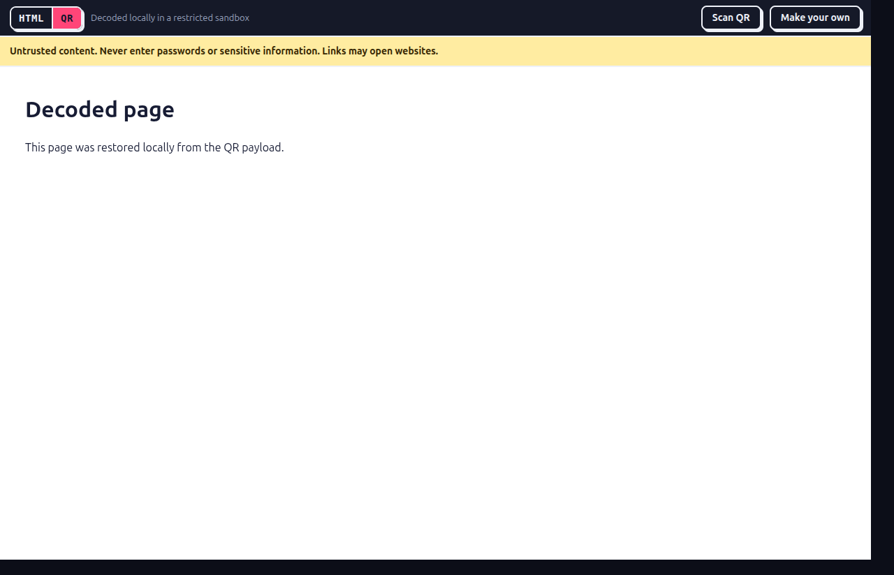

# HTML to QR

Create a QR code that carries a small HTML page. Edit and preview the source in your browser, generate and download the QR image, then scan it to rebuild the page locally.

[Open the hosted app](https://html2qr.vercel.app)

If HTML to QR is useful to you, please [star the repository on GitHub](https://github.com/silven-mohan/html2qr).


## Features

- **Two QR formats:** GZIP-compressed HTML in an app link, or HTML embedded directly in a `data:text/html` URL.
- **HTML minification:** Optionally removes comments and collapses whitespace before encoding, while preserving the contents of `script`, `pre`, and `textarea` elements.
- **Live capacity meter:** Shows payload size and remaining capacity for QR error-correction levels L, M, Q, and H. Generation is disabled when the payload exceeds the selected limit.
- **Live preview:** Opens an inline sandboxed preview that stays in sync as the HTML editor changes.
- **Branded QR image export:** Downloads a PNG with the site favicon and name beneath the QR. The branding stays outside the code so it does not cover QR modules.
- **Eight editable templates:** Start from invitations, cards, event designs, tickets, or a name badge, edit the fields with a live preview, then continue in either QR encoding mode.
- **Animated QR intro:** A QR code bursts into particles when the app opens. Skip it at any time; it is automatically skipped when reduced motion is enabled.
- **Built-in QR scanner:** Opens from the app header and decoded-page toolbar. It requests camera access and fills the available viewport on phone, landscape, and desktop displays. It opens compressed HTMLQR payloads, follows scanned web links, and displays scanned `data:text/html` URLs in the app. The video uses `object-fit: contain` so the camera image is not cropped.
- **Optional password protection:** Encrypts compressed payloads with AES-256-GCM and a PBKDF2-SHA-256-derived key. The receiver enters the password to decrypt in the browser. Password fields include show/hide controls.
- **Untrusted-page safeguards:** Decoded pages require confirmation. Scripts and automatic refresh redirects are removed; forms, popups, and external resources are blocked. Clicked links may still navigate inside the sandbox, and the persistent warning advises against entering sensitive information.
- **Responsive interface:** Workbench controls adapt to narrow screens; the scanner uses the full dynamic viewport and accounts for device safe areas.


## Encoding methods

Choose how the HTML should travel in the QR code:

- **Compress, then decode on a page:** The app optionally minifies and GZIP-compresses the HTML, then Base64-encodes it in a single byte-mode URL for broad scanner compatibility. The QR holds a link to the app with its payload in the URL fragment. New unencrypted payloads use `HTMLQR1:` and password-encrypted payloads use `HTMLQR2:`. Existing compact `HTMLQR3:` and `HTMLQR4:` Base43 payloads are still supported. Set the hosted-app URL in the workbench so scanning opens the decoder. This mode needs the decoder app.
- **Convert to a data URL:** The app optionally minifies the HTML and embeds it directly in a `data:text/html` URL. No decoder or hosted app URL is needed, but the uncompressed content must fit the QR. If another scanner shows the URL as text, use this app's **Scan QR** control to get its confirmation and restricted viewer. Opening the data URL directly bypasses those safeguards.



### Password encryption

Password protection is available in compressed mode. When enabled, the compressed bytes are encrypted using AES-256-GCM. A key is derived from the password with PBKDF2-SHA-256; a random salt and IV are carried in the encrypted QR payload, marked `HTMLQR2:`. The password itself is never included. The receiving browser prompts for it and supports retrying after an incorrect password. Existing `HTMLQR4:` encrypted compact codes are still supported.



Password encryption requires Web Crypto in a secure context: use the hosted HTTPS app or localhost. Keep the password separate from the QR. Anyone with the QR and password can read its page, and weak passwords may be guessed offline.

## Create, preview, and save

1. Open [html2qr.vercel.app](https://html2qr.vercel.app).
2. Select the compressed or data URL method.
3. Paste or edit your HTML. In compressed mode, verify the hosted app URL; it is filled in automatically on the hosted site.
4. Choose whether to minify and select the error-correction level. To protect compressed content, enter a password.
5. Select **Live preview** to inspect the current HTML. The preview updates as the editor changes and runs in a sandbox.
6. Select **Generate QR code**, then **Download PNG** to save the generated image.


## Use a template

Open **Templates** from the home screen and choose one of eight layouts: wedding invitation, birthday, business card, contact card, event poster, event ticket, thank-you card, or name badge. Fill in the template fields and check the live preview as it updates. Select **Use with Compress** or **Use with Data URL** to carry the finished HTML into that workbench, where you can adjust it further, preview it, and generate the QR code as usual.

Template field values are HTML-escaped before being added to the generated page. Email and phone fields in the contact-card template are linked for quick contact from a phone.

## Scan and open

Select **Scan QR** from the app header or decoded-page toolbar and allow camera access. The scanner occupies the full available viewport, including mobile safe areas, and keeps the complete camera frame visible without cropping. Camera access requires HTTPS or localhost and browser permission. The app tries the browser's `BarcodeDetector` when available, then falls back to `jsQR` if no QR is detected.

The scanner capture below shows its camera-permission status; when permission is granted, the camera feed occupies the same full-screen area.


After scanning a compressed QR or a `data:text/html` URL, the app asks before displaying the page. Decoded scripts and automatic meta-refresh redirects are removed, the iframe sandbox disables scripts, forms, and popups, and a restrictive CSP blocks external subresources and form submissions in the decoded document. Links remain clickable and can navigate the sandboxed frame to another site, so only open links you trust. Encrypted codes first request their password in the app UI, outside the decoded page. Opening a data URL directly in another app or browser bypasses these safeguards.




The meter compares payload size against Version 40 byte-mode capacities: L 2,953 bytes, M 2,331, Q 1,663, and H 1,273. Higher error correction can help a code recover from damage, but leaves less room for data. The generator uses the smallest QR version that fits.

## Run locally

This is a static browser app. Serve the project directory over HTTP (localhost is treated as a secure context by modern browsers):

```sh
python3 -m http.server 8000
```

Then visit <http://localhost:8000>. Compression and decompression use the browser's `CompressionStream` and `DecompressionStream`; password encryption uses Web Crypto. QR generation and the scanner fallback are loaded from CDNs, so those features need an internet connection. Camera access requires HTTPS or localhost and browser permission.

To deploy your own copy, host the files as a static site and use that site's base URL in the compressed-mode URL field. The URL must point to the app that will decode the `HTMLQR1:` and `HTMLQR2:` fragments. Existing `HTMLQR3:` and `HTMLQR4:` compact payloads are also supported.

## Privacy and security

- HTML generation, compression, encryption, and decryption happen in the browser; the app does not upload the page source to a backend.
- Compressed payloads are carried in the QR's URL fragment, not stored as server-side page data.
- Password-protected payloads use authenticated AES-GCM encryption. The password is not embedded in the code.
- Decoded HTML requires confirmation and runs in an opaque-origin sandbox with scripts, forms, and popups disabled. Scripts and automatic meta-refresh redirects are removed before display; a restrictive CSP blocks external subresources and form submissions in the decoded document. Links clicked inside the page can still navigate the sandboxed frame to another site. Opening a data URL outside the app bypasses these protections.
- The app keeps an untrusted-content warning visible while a decoded page is open. Do not enter passwords or sensitive information into scanned pages.
- Unencrypted QR codes are readable by anyone who obtains them. Do not encode secrets or sensitive data without password protection.

## Project files

- `index.html` contains the app interface and dialogs.
- `script.js` implements minification, payload encoding and decoding, encryption, QR rendering, live preview, and camera scanning.
- `qr-burst.js` defines the animated `<qr-burst>` intro component.
- `style.css` contains the responsive app, scanner, and dialog styles.
- `assets/` contains the favicon, workflow and capacity illustrations, and app screenshots used in this guide.

## License

This project is distributed under the [Apache License 2.0](LICENSE). See the license file for the full terms.