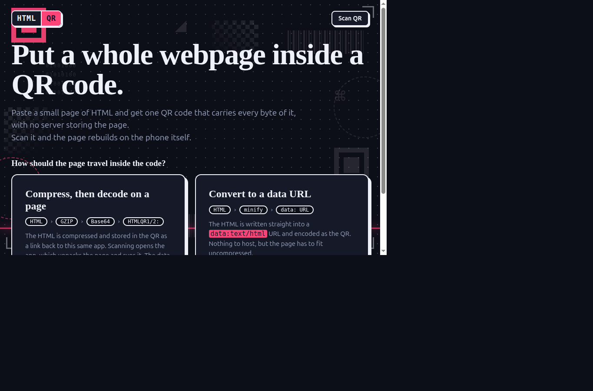
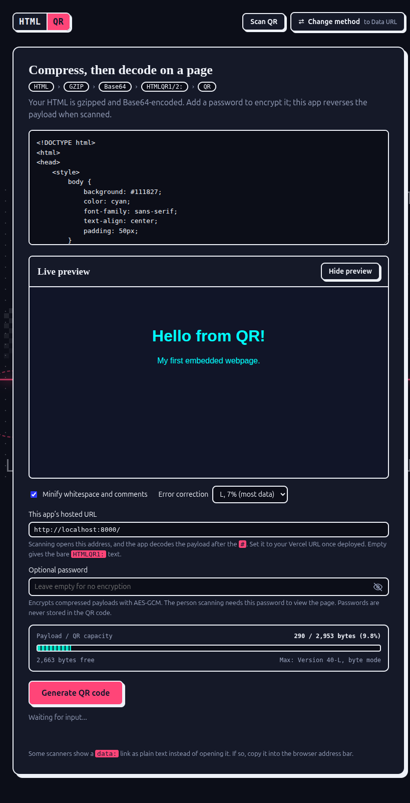
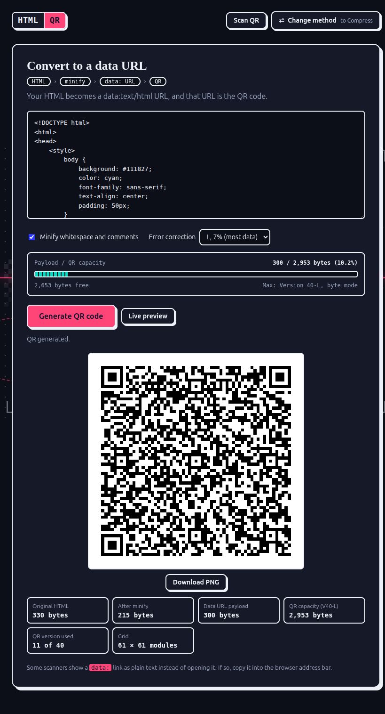
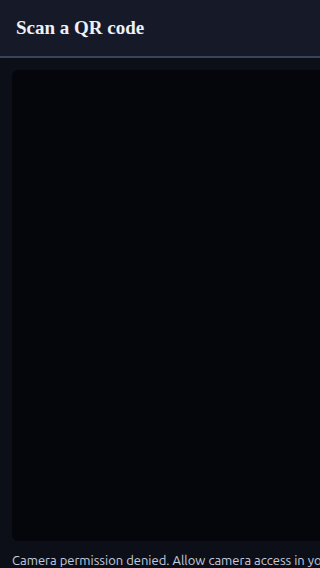

# HTML to QR

Create a QR code that carries a small HTML page. Edit and preview the source in your browser, generate and download the QR image, then scan it to rebuild the page locally.

[Open the hosted app](https://html2qr.vercel.app)



## Features

- **Two QR formats:** GZIP-compressed HTML in an app link, or HTML embedded directly in a `data:text/html` URL.
- **HTML minification:** Optionally removes comments and collapses whitespace before encoding, while preserving the contents of `script`, `pre`, and `textarea` elements.
- **Live capacity meter:** Shows payload size and remaining capacity for QR error-correction levels L, M, Q, and H. Generation is disabled when the payload exceeds the selected limit.
- **Live preview:** Opens an inline sandboxed preview that stays in sync as the HTML editor changes.
- **QR image export:** Downloads generated QR codes as PNG.
- **Built-in QR scanner:** Opens from the app header and decoded-page toolbar. It requests camera access and fills the available viewport on phone, landscape, and desktop displays. The video uses `object-fit: contain` so the camera image is not cropped.
- **Optional password protection:** Encrypts compressed payloads with AES-256-GCM and a PBKDF2-SHA-256-derived key. The receiver enters the password to decrypt in the browser. Password fields include show/hide controls.
- **Sandboxed decoded page:** Reconstructed HTML is displayed in a sandboxed iframe.
- **Responsive interface:** Workbench controls adapt to narrow screens; the scanner uses the full dynamic viewport and accounts for device safe areas.


## Encoding methods

Choose how the HTML should travel in the QR code:

- **Compress, then decode on a page:** The app optionally minifies and GZIP-compresses the HTML, then encodes it using URL-safe Base64. The QR holds a link to the app with its payload in the URL fragment. The unencrypted format uses `HTMLQR1:`. Set the hosted-app URL in the workbench so scanning opens the decoder. This mode fits more HTML but needs the decoder app.
- **Convert to a data URL:** The app optionally minifies the HTML and embeds it directly in a `data:text/html` URL. No decoder or hosted app URL is needed, but the uncompressed content must fit the QR. Some scanner apps show data URLs as text; if so, copy the URL into a browser address bar.


### Password encryption

Password protection is available in compressed mode. When enabled, the compressed bytes are encrypted using AES-256-GCM. A key is derived from the password with PBKDF2-SHA-256; a random salt and IV are carried in the encrypted QR payload, marked `HTMLQR2:`. The password itself is never included. The receiving browser prompts for it and supports retrying after an incorrect password.


Password encryption requires Web Crypto in a secure context: use the hosted HTTPS app or localhost. Keep the password separate from the QR. Anyone with the QR and password can read its page, and weak passwords may be guessed offline.

## Create, preview, and save

1. Open [html2qr.vercel.app](https://html2qr.vercel.app).
2. Select the compressed or data URL method.
3. Paste or edit your HTML. In compressed mode, verify the hosted app URL; it is filled in automatically on the hosted site.
4. Choose whether to minify and select the error-correction level. To protect compressed content, enter a password.
5. Select **Live preview** to inspect the current HTML. The preview updates as the editor changes and runs in a sandbox.
6. Select **Generate QR code**, then **Download PNG** to save the generated image.





## Scan and open

Select **Scan QR** from the app header or decoded-page toolbar and allow camera access. The scanner occupies the full available viewport, including mobile safe areas, and keeps the complete camera frame visible without cropping. Camera access requires HTTPS or localhost and browser permission. The app uses the browser's `BarcodeDetector` when available and a `jsQR` fallback otherwise.

The scanner capture below shows its camera-permission status; when permission is granted, the camera feed occupies the same full-screen area.



After scanning a compressed QR, the app decodes its fragment locally and displays the page in a sandboxed iframe. Encrypted codes first request their password.


The meter uses the Version 40 byte-mode maximum for each error-correction level: L 2,953 bytes, M 2,331, Q 1,663, and H 1,273. Higher correction can help a code recover from damage, but leaves less room for data. The generator uses the smallest QR version that fits.

## Run locally

This is a static browser app. Serve the project directory over HTTP (localhost is treated as a secure context by modern browsers):

```sh
python3 -m http.server 8000
```

Then visit <http://localhost:8000>. Compression and decompression use the browser's `CompressionStream` and `DecompressionStream`; password encryption uses Web Crypto. QR generation and the scanner fallback are loaded from CDNs, so those features need an internet connection. Camera access requires HTTPS or localhost and browser permission.

To deploy your own copy, host the files as a static site and use that site's base URL in the compressed-mode URL field. The URL must point to the app that will decode the `HTMLQR1:` fragment.

## Privacy and security

- HTML generation, compression, encryption, and decryption happen in the browser; the app does not upload the page source to a backend.
- Compressed payloads are carried in the QR's URL fragment, not stored as server-side page data.
- Password-protected payloads use authenticated AES-GCM encryption. The password is not embedded in the code.
- Decoded HTML runs in a sandboxed iframe that allows scripts, forms, and popups but does not grant same-origin access.
- Unencrypted QR codes are readable by anyone who obtains them. Do not encode secrets or sensitive data without password protection.

## Project files

- `index.html` contains the app interface and dialogs.
- `script.js` implements minification, payload encoding and decoding, encryption, QR rendering, live preview, and camera scanning.
- `qr-burst.js` defines the animated `<qr-burst>` intro component.
- `style.css` contains the responsive app, scanner, and dialog styles.
- `assets/` contains the workflow and capacity illustrations plus rendered app screenshots used in this guide.

## License

This project is distributed under the [Apache License 2.0](LICENSE). See the license file for the full terms.